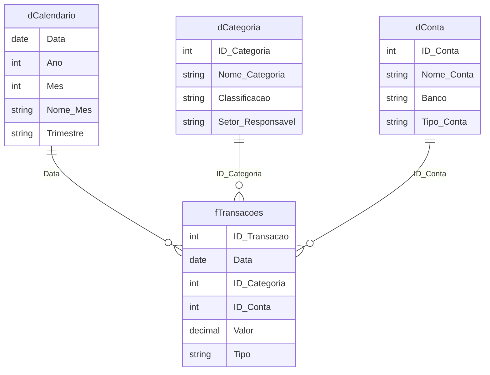

# 📊 Finance Dashboard — Inteligência de Negócios & Indicadores Financeiros

Projeto de Business Intelligence focado na modelagem dimensional, criação de medidas analíticas com **DAX**, estruturação de pipelines de transformação no **Power Query** e visualização executiva de indicadores financeiros no **Power BI** e **Excel**.

---

## 🛠️ Tecnologias e Metodologias

- **Visualização & BI:** Microsoft Power BI Desktop, Microsoft Excel Avançado
- **Linguagem de Cálculo:** DAX (*Data Analysis Expressions*)
- **Transformação & Limpeza:** Power Query (M)
- **Modelagem de Dados:** Esquema Estrela (*Star Schema* com tabelas Fato e Dimensão)

---

## 📐 Modelagem Dimensional (Star Schema)

O projeto foi estruturado seguindo as melhores práticas de Engenharia de BI, separando transações operacionais de tabelas de contexto:



---

## 📈 Principais Medidas DAX Implementadas

As métricas do dashboard foram implementadas utilizando medidas dinâmicas em DAX:

### 1. Total de Receitas
```dax
Total Receitas = 
CALCULATE(
    SUM(fTransacoes[Valor]),
    fTransacoes[Tipo] = "Receita"
)
```

### 2. Total de Despesas
```dax
Total Despesas = 
CALCULATE(
    SUM(fTransacoes[Valor]),
    fTransacoes[Tipo] = "Despesa"
)
```

### 3. Lucro Líquido
```dax
Lucro Liquido = [Total Receitas] - [Total Despesas]
```

### 4. Margem Líquida (%)
```dax
Margem Liquida % = 
DIVIDE([Lucro Liquido], [Total Receitas], 0)
```

### 5. Comparativo Mensal (MoM - Month over Month)
```dax
Receita Mes Anterior = 
CALCULATE(
    [Total Receitas],
    DATEADD(dCalendario[Data], -1, MONTH)
)
```

---

## 📁 Estrutura de Arquivos no Repositório

```text
├── data/
│   ├── fTransacoes.csv    # Tabela Fato com movimentações financeiras
│   ├── dCalendario.csv    # Tabela Dimensão de Tempo (Ano, Mês, Trimestre)
│   ├── dCategoria.csv     # Dimensão com categorias e setores
│   └── dConta.csv         # Dimensão de contas e instituições bancárias
├── docs/
│   └── dicionario_dados.md # Dicionário de dados das tabelas
└── README.md              # Documentação completa do projeto
```

---

## 🚀 Como Utilizar este Projeto no Power BI

1. Abra o **Power BI Desktop**.
2. Clique em **Obter Dados** > **Texto/CSV** e carregue os 4 arquivos da pasta `/data`.
3. Na aba **Modelo**, verifique as relações 1 para Muitos (`1:*`) entre as tabelas de dimensão e a tabela fato `fTransacoes`.
4. Crie uma nova tabela de medidas chamada `_Medidas` e insira as fórmulas DAX listadas acima.
5. Construa os visuais executivos: Cartões de KPI, Gráfico de Linha temporal e Gráfico de Barras por Categoria.

---

## 👤 Autor

**Daniel Expedito Ramos de Sousa**  
[LinkedIn](https://linkedin.com/in/daniel-expedito/) | [GitHub](https://github.com/Daniellramos09)
